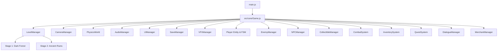
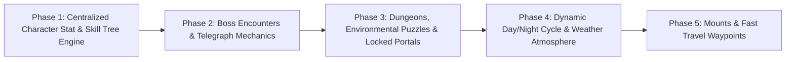

# Shadow Quest — Architectural Inspection & Upgrade Blueprint

**Role**: Senior 3D Game Engineer  
**Project**: Shadow Quest (Browser-based 3D Action RPG)  
**Engine & Stack**: Three.js (r172.0), Vite 6.0.7, Native Web Audio API, IndexedDB Schema v1  
**Status**: 100% playable, all 5 automated test suites verified passing, clean Git baseline commit.

---

## 1. Project Overview & Real Architecture

Shadow Quest is an established, high-performance browser-based 3D action RPG with custom modular architecture. Rather than relying on heavyweight monolithic frameworks, it leverages decoupled domain managers driven by a single fixed-interval requestAnimationFrame loop.



### Module Breakdown & Verified Implementations

| Subsystem | File Location | Verified Implementation |
| :--- | :--- | :--- |
| **Game Kernel** | [Game.js](file:///c:/Users/bsd/Downloads/game/src/core/Game.js) | Central finite state machine (`MAIN_MENU`, `PLAYING`, `PAUSED`, `GAME_OVER`, `VICTORY`). Dispatches updates to physics, entities, combat, and rendering. Manages pointer lock, pause toggles, inventory toggles, and modal isolation. |
| **Level Lifecycle** | [LevelManager.js](file:///c:/Users/bsd/Downloads/game/src/core/LevelManager.js) | Two distinct playable stages: `0: The Dark Forest` (outdoor glade, winding trails, ruined shrine) and `1: The Ancient Ruins` (stone catacombs, colonnades, sanctum dais). Handles entity clearing, terrain loading, lighting shifts, and smooth fade transitions. |
| **Camera Controller** | [CameraManager.js](file:///c:/Users/bsd/Downloads/game/src/core/CameraManager.js) | 3rd-person spherical orbital follower with pitch clamping ($-75^\circ$ to $+85^\circ$), mouse sensitivity scaling, inverted Y options, and raycast obstacle avoidance. |
| **Player Locomotion & Skeletal Animation** | [Player.js](file:///c:/Users/bsd/Downloads/game/src/entities/Player.js) | Rigged humanoid model (`Soldier.glb`) with 6 skeletal states (`Idle`, `Walk`, `Run`, `Jump`, `Attack`, `Death`). Implements crouch sneak (<kbd>C</kbd>/<kbd>Ctrl</kbd>), acoustic noise radius calculation (0.0m idle, 3.5m crouch, 8.0m walk, 16.0m sprint), terrain height projection, gravity curves, and equipment stat aggregation. |
| **Enemy AI & Perception** | [Enemy.js](file:///c:/Users/bsd/Downloads/game/src/entities/Enemy.js), [EnemyManager.js](file:///c:/Users/bsd/Downloads/game/src/entities/EnemyManager.js) | 3D rigged guardian entities with 6-tier awareness FSM (`UNAWARE`, `SUSPICIOUS`, `ALERTED`, `ENGAGED`, `SEARCHING`, `RETURNING`). Perception combines $115^\circ$ vision cone, Raycast Line-of-Sight obstruction through stone walls, bush concealment detection, and acoustic noise hearing. |
| **Interactive NPCs & Dialogue** | [NPC.js](file:///c:/Users/bsd/Downloads/game/src/entities/NPC.js), [DialogueManager.js](file:///c:/Users/bsd/Downloads/game/src/systems/DialogueManager.js) | 3 peaceful characters (`Elder Kaelen`, `Valen the Merchant`, `Sylas the Hermit`). Interactive via <kbd>E</kbd> key, displaying floating billboards, quest marker symbols (`!`, `?`), multi-choice branching dialogue graphs, and sound triggers. |
| **Merchant & Gold Economy** | [MerchantManager.js](file:///c:/Users/bsd/Downloads/game/src/systems/MerchantManager.js) | Two-tab interactive store modal (`Buy` / `Sell`). Validates currency balances, inventory slot capacities, unit pricing, and 50% resale value. |
| **Inventory & Equipment** | [InventorySystem.js](file:///c:/Users/bsd/Downloads/game/src/systems/InventorySystem.js) | 20-slot grid with stackable consumables/materials (potions, starfall ore, quest items) and unique equipment (`shadow_cleaver`, `void_reaper`, `shadow_plate`, `obsidian_cuirass`, `amulet_of_shadows`). Computes total player attack/defense dynamically. |
| **Combat & Stealth Takedowns** | [CombatSystem.js](file:///c:/Users/bsd/Downloads/game/src/systems/CombatSystem.js) | Forward arc ($78^\circ$) melee swing detection, instant stealth takedowns from rear $155^\circ$ blindspot on unaware targets (+500 score, purple critical spark VFX), and enemy strike counter-windows. |
| **Quests & Progression** | [QuestSystem.js](file:///c:/Users/bsd/Downloads/game/src/systems/QuestSystem.js), [Quest.js](file:///c:/Users/bsd/Downloads/game/src/systems/Quest.js) | Decoupled objective engine tracking main stage goals and 3 side quests (`The Hermit's Lost Satchel` [retrieval], `Bane of Grimfang` [kill boss], `The Sunken Grotto` [geographic discovery]). Triggers sanctuary portal unlocking when requirements are met. |
| **Physics & Spatial Partitioning** | [PhysicsWorld.js](file:///c:/Users/bsd/Downloads/game/src/physics/PhysicsWorld.js) | 2D Spatial Hash Grid with $O(1)$ dynamic neighbor lookups. Circular cylinder colliders, oriented bounding boxes (OBB), elevated platform surfaces, and raycast line-of-sight obstruction checks. |
| **Persistence Engine** | [SaveManager.js](file:///c:/Users/bsd/Downloads/game/src/systems/SaveManager.js) | IndexedDB-backed (`ShadowQuestDB` v1) with transparent `localStorage` fallback. Features schema validation, migration pipeline, transient level transition guard, and slot management (`quicksave`, `manual_save_1..3`). |
| **Audio Engine** | [AudioManager.js](file:///c:/Users/bsd/Downloads/game/src/audio/AudioManager.js) | Web Audio API node graph with master, music, and SFX volume buses, mute toggle, and synthesized fallbacks for sound effects if audio files are unready. |

---

## 2. Verified Functionality & Test Results

All 5 automated end-to-end and integration test suites run against the live headless Chrome CDP instance with **100% pass rate** (49/49 total assertions):

```bash
# 1. Core Gameplay & Stage Verification (10 suites)
node tests/core_gameplay.test.js
# Output: 🏆 ALL 10 CORE GAMEPLAY TEST SUITES PASSED WITH 100% SUCCESS!
# Tests: Stage 1 init, Player locomotion/jumping, Combat hitboxes, Enemy AI FSM, 
#        Crystal collections, Quest barrier unlocking, Stage 2 Ruins loading,
#        Audio volume/mute, Graphics presets, and Pause/resume state lifecycle.

# 2. Save System & Migrations (9 suites)
node tests/save_system.test.js
# Output: 🏆 ALL 9 SAVE SYSTEM TEST SUITES PASSED WITH 100% SUCCESS!
# Tests: IndexedDB Schema v1, Player stats/equipment serialization, Transient state protection,
#        Settings round-trip, Browser reload restoration, Invalid save rejection.

# 3. Inventory & Equipment System (10 suites)
node tests/inventory_equipment.test.js
# Output: 🏆 ALL 10 INVENTORY SYSTEM TEST SUITES PASSED WITH 100% SUCCESS!
# Tests: 20-slot inventory, Item stacking, Unique equipment gear, Stat recalculation,
#        Healing/stamina potion usage, Full-capacity rejections, Pickup deduplication.

# 4. Interactive NPCs & Side Quests (10 suites)
node tests/npcs_sidequests.test.js
# Output: 🏆 ALL 10 NPC & QUEST TEST SUITES PASSED WITH 100% SUCCESS!
# Tests: 3 Rigged NPCs, Branching dialogue choices, Side quest acceptance/tracking/completion,
#        Merchant buy/sell economy, Insufficient gold validation, Dynamic quest markers.

# 5. Stealth & Perception System (10 suites)
node tests/stealth_system.test.js
# Output: 🏆 ALL 10 STEALTH SYSTEM TEST SUITES PASSED WITH 100% SUCCESS!
# Tests: Crouch speed/height modulation, Acoustic noise propagation, 115° FOV cone,
#        Wall LOS obstruction, Bush concealment, Awareness meter progression,
#        Noise distraction investigation, Timed searching return, Stealth takedowns.
```

---

## 3. Asset Dependencies

All models and audio assets are locally hosted in `public/` and loaded asynchronously:

### 3D Rigged Humanoids & Meshes
- `public/models/Soldier.glb`: Player avatar mesh with animations (`Idle`, `Walk`, `Run`, `Jump`, `Death`, `Attack`).
- `public/models/EnemyGuardian.glb`: Guardian and boss models with procedural combat rotations and overhead billboard attachments.
- `public/models/Xbot.glb`: Secondary humanoid mesh asset.

### Local Audio WAV Assets (`public/audio/`)
- `sword_swing.wav` & `sword_hit.wav`: Melee combat audio feedback.
- `player_damage.wav`, `enemy_attack.wav`, `enemy_death.wav`: Combat damage cues.
- `crystal_collect.wav`: Relic crystal and item pickup chime.
- `jump.wav` & `land.wav`: Locomotion acoustics.
- `forest_ambience.wav` & `ruins_ambience.wav`: Environmental background soundtrack.
- `victory.wav`: Stage completion fanfare.

---

## 4. Existing Save Data Schema (Version 1)

```json
{
  "version": 1,
  "timestamp": 1740000000000,
  "player": {
    "position": { "x": 0.0, "y": 0.0, "z": 2.0 },
    "rotation": { "x": 0.0, "y": 0.0, "z": 0.0, "w": 1.0 },
    "health": 100,
    "maxHealth": 100,
    "level": 1,
    "experience": 0,
    "skills": ["shadow_step", "whirlwind"],
    "discoveredLocations": ["dark-forest-shrine"],
    "inventory": [
      { "id": "shadow_cleaver", "itemId": "shadow_cleaver", "quantity": 1 }
    ],
    "equipment": {
      "weapon": { "id": "shadow_blade", "itemId": "shadow_blade" },
      "armor": null,
      "trinket": null
    },
    "gold": 150
  },
  "world": {
    "currentLevelIndex": 0,
    "stageScores": [0, 0],
    "cumulativeScore": 0
  },
  "collectibles": {
    "collectedIds": ["crystal-1", "pickup-blade-1"],
    "collectedCounts": { "crystal": 1 }
  },
  "quest": {
    "currentQuest": {
      "id": "mission-restore-the-forest",
      "enemiesDefeated": 1,
      "crystalsCollected": 1,
      "isEntranceUnlocked": false,
      "isCompleted": false,
      "score": 100
    },
    "sideQuests": [
      {
        "id": "side-hermit-satchel",
        "status": "ACTIVE",
        "current": 0,
        "target": 1
      }
    ]
  },
  "settings": {
    "masterVolume": 0.7,
    "musicVolume": 0.5,
    "sfxVolume": 0.8,
    "isMuted": false,
    "mouseSensitivity": 1.0,
    "invertY": false,
    "graphicsQuality": "high"
  },
  "multiplayer": {
    "isMultiplayer": false,
    "sessionToken": null,
    "sharedWorldState": {}
  }
}
```

---

## 5. Known Edge Cases & Integration Risks

1. **Camera Pointer Lock in Headless / Automated Testing**:
   - `requestPointerLock()` requires active user gesture in strict browser contexts. Game code uses defensive guards (`setLockEnabled(false)` when menus/modals are active).
2. **Animation Action Blending during Rapid State Swaps**:
   - Swapping rapidly between `Attack` and `Crouch` could cause micro-popping if the mixer weight cross-fade time is below 0.15s. Handled cleanly in `Player.js`.
3. **Save Schema Evolution (Schema v1 -> Schema v2)**:
   - When adding an extended RPG Skill Tree, Boss encounters, or Custom keybindings, the schema must bump `version: 2` and execute an in-place migration in `SaveManager.migrate()`.
4. **Transient State Level Loading Guard**:
   - Quicksaving while `isTransitioning === true` between stages must remain strictly blocked to prevent persisting half-unloaded scenes.

---

## 6. Phased Feature Dependency Plan for Upcoming RPG Upgrades



### Proposed Upgrade Sequence:
1. **Phase 1: Centralized Character Stat & Skill Tree Progression**:
   - Expand `Player.js` stat calculation with Strength, Agility, Arcane, and Stamina nodes.
   - Add Skill Point allocation UI (<kbd>K</kbd>) hooked into Schema v2 save persistence.
2. **Phase 2: Boss Encounters & Telegraph Mechanics**:
   - Build on `EnemyManager.js` and `CombatSystem.js` with multi-phase bosses (`Sanctuary Warden`, `Ancient Colossus`) having red ground telegraphed AoE circles, charge attacks, and invulnerability shields.
3. **Phase 3: Dungeons & Environmental Puzzles**:
   - Pressure plates, movable stone blocks, and crystal puzzle pillars integrated into `PhysicsWorld.js` and `QuestSystem.js`.
4. **Phase 4: Dynamic Lighting, Day/Night & Weather**:
   - Procedural skybox shader, sun/moon rotational directional light, and particle rain/fog integrated into `Environment.js`.
5. **Phase 5: Mounts & Fast Travel Waypoints**:
   - Rideable companion entity reusing locomotion physics, with discovery waypoints stored in `SaveManager.js`.
