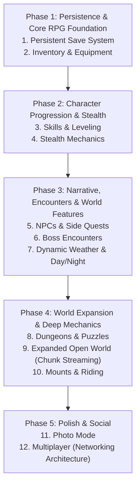

# Shadow Quest - Architectural Upgrade Plan 🏰

**Target**: Comprehensive, modular upgrades for the completed and production-ready *Shadow Quest* 3D third-person adventure game.  
**Baseline Version**: v0.2.0 (Verified clean build, 20/20 QA suites passed, Git checkpoint `9e30297`).  
**Guiding Rule**: **Preserve 100% of existing working gameplay features.** All upgrades must be additive, modular, and non-destructive.

---

## 1. Existing System Architecture & Communication Map

```
┌─────────────────────────────────────────────────────────────────────────────────────────┐
│                                       Game.js                                           │
│               Central Game State Machine ('MAIN_MENU'|'PLAYING'|'PAUSED'|'GAME_OVER'|'VICTORY') │
└──────┬────────────┬─────────────┬─────────────┬──────────────┬────────────┬─────────────┘
       │            │             │             │              │            │
       ▼            ▼             ▼             ▼              ▼            ▼
┌──────────────┐ ┌──────────────┐ ┌──────────┐ ┌─────────────┐ ┌──────────┐ ┌────────────┐
│ PhysicsWorld │ │ Environment  │ │ Camera   │ │ Audio       │ │ VFX      │ │ UI         │
│ - Spatial Grid│ │ - Terrain   │ │  Manager │ │  Manager    │ │  Manager │ │  Manager   │
│ - Colliders  │ │ - Ruins      │ │ - Orbit  │ │ - Web Audio │ │ - Trails │ │ - HUD/Menu │
│ - Platforms  │ │ - Vegetation │ │ - Avoid  │ │ - SFX/Music │ │ - Sparks │ │ - Modals   │
└──────▲───────┘ └──────▲───────┘ └────▲─────┘ └──────▲──────┘ └────▲─────┘ └─────▲──────┘
       │                │              │              │             │             │
       ├────────────────┴──────────────┴──────────────┴─────────────┴─────────────┤
       │                                                                          │
 ┌─────┴──────┐                ┌──────────────┐                            ┌──────┴──────┐
 │ Player     │ ◄── Combat ──► │ EnemyManager │                            │ Collectible │
 │ - Skinned  │     System     │ - AI States  │                            │  Manager    │
 │ - Movement │                │ - Guardians  │                            │ - Crystals  │
 └─────┬──────┘                └──────┬───────┘                            └──────┬──────┘
       │                              │                                           │
       └──────────────────────────────┼───────────────────────────────────────────┘
                                      ▼
                               ┌──────────────┐
                               │ QuestSystem  │ ◄─── LevelManager (Stages & Resets)
                               │ - Objectives │
                               │ - Barriers   │
                               └──────────────┘
```

### Communication Protocols
- **Physics**: Entities query `PhysicsWorld.resolveCollisions(pos, radius, height)` and `PhysicsWorld.getGroundHeight(x, z, y)` for fast $O(1)$ spatial collision resolution.
- **Combat**: `CombatSystem` reconciles `Player.getSwordTipPosition()` against `enemy.position` / `radius`, applies damage, triggers `VFXManager` hit particles and floating damage numbers, and routes defeat events to `QuestSystem`.
- **Level Lifecycle**: `LevelManager` orchestrates stage loading (Stage 1: *The Dark Forest*, Stage 2: *The Ancient Ruins*), resets entity registries, and invokes `UIManager.transitionLevel()`.

---

## 2. Upgrade Feature Inventory & Overlap Reuse Analysis

| Planned Upgrade | Existing Overlapping System | Reuse & Integration Strategy |
|---|---|---|
| **1. Persistent Save System** | `LevelManager` (scores, stage index), `Player` (HP, stats), `QuestSystem` (objectives) | Create `SaveManager` serializing state to `localStorage`. Integrate `AutoSave` on stage transitions and quest completion; add "Save / Load Game" in Pause and Main Menu. |
| **2. Inventory & Equipment** | `CollectibleManager` (item tracking), `Sword.js` (hand-bone attachment) | Extend `Collectible` to support inventory items (consumables, quest keys, weapons, armors). Add an inventory modal in `UIManager` and socket attachments to character bones (`hand_r`, `hand_l`, `spine`). |
| **3. Skills & Leveling** | `CombatSystem` (score bonuses), `Player` (stats, speed, jump, damage) | Introduce `ProgressionSystem`. Enemies award XP on defeat (`onEnemyDefeated`). Level-ups award skill points to unlock abilities (e.g. Whirlwind Slash, Dash, Health Boost) reflected in HUD. |
| **4. NPCs & Side Quests** | `Enemy.js` (mesh, waypoints, rotation), `QuestSystem` & `QuestObjective` (declarative tasks) | Create `NPC` class inheriting waypoint navigation with peaceful interaction zones. Extend `QuestSystem` to track multiple simultaneous secondary quests. |
| **5. Stealth Mechanics** | `Enemy.js` (`detectionRadius`, `patrolCenter`, AI states: `IDLE`, `PATROL`, `DETECT`, `CHASE`) | Add vision field-of-view cone check in `Enemy.js`. Add `Crouch` stance in `Player.js` reducing player height, detection radius, and footstep noise. Add backstab damage multiplier. |
| **6. Dungeons & Puzzles** | `RuinsStage.js` & `Ruins.js` (doors, portals, barriers), `PhysicsWorld` (platforms, OBB colliders) | Build puzzle triggers (pressure pads, sequence levers, movable stone blocks) using existing box colliders and platform height steppers. |
| **7. Boss Encounters** | `EnemyManager` (elite guardian configurations, Colossus boss), `UIManager` (`#targeted-enemy-hud`) | Elevate Colossus/Void Golems with multi-phase state machines, telegraph ground markers via `VFXManager`, minion summon waves, and dedicated boss music. |
| **8. Expanded Open World** | `Terrain.js` (canvas heightmap generation), `Vegetation.js` (scatter), `PhysicsWorld` (spatial hash grid) | Evolve `Terrain.js` into chunk-based streaming grid (`TerrainChunkManager`) that generates/recycles terrain tiles around player coordinates. |
| **9. Dynamic Weather & Day/Night** | `Environment.js` (sun, hemisphere light, fog), `VFXManager` (particle pools) | Add diurnal clock rotating celestial directional light and modifying sky/fog colors. Add rain/fog weather particle systems to `VFXManager` with ambient sound cross-fades. |
| **10. Mounts & Riding** | `Player.js` (locomotion & physics), `CameraManager` (orbit follow) | Create `Mount` entity. When mounting, adventurer snaps to mount saddle bone, player locomotion delegates to mount physics (higher speed, jump height), and camera distance scales out. |
| **11. Photo Mode** | `CameraManager` (azimuth/pitch, smooth lerp), `Game.js` (pause state) | Freeze game simulation while keeping camera orbit interactive; decouple camera from player follow; add visual filter sliders (FOV, DOF, exposure, vignette) and PNG capture. |
| **12. Multiplayer** | `Player.js` (transform, animation state, weapon trail), `CombatSystem` | Implement client-side `RemotePlayer` entity. Synchronize position, rotation, animation clip, and attack swings via lightweight WebSocket / WebRTC messaging. |

---

## 3. Risk Assessment & Mitigation Strategies

```
HIGH REGRESSION RISK:
┌─────────────────────────┐
│ 12. Multiplayer         │ -> Complex state reconciliation, latency compensation.
│  8. Expanded Open World │ -> Memory leaks, chunk seam physics glitches, drop in frame rate.
└─────────────────────────┘

MEDIUM REGRESSION RISK:
┌─────────────────────────┐
│  5. Stealth Mechanics   │ -> Modifying Enemy AI detection loops could break aggro/combat.
│ 10. Mounts & Riding     │ -> Swapping locomotion and camera anchors risks physics tunneling.
│  2. Inventory & Equip   │ -> Bone attachments and weapon hitbox collision offsets.
│  1. Save System         │ -> Corrupted state on schema migrations.
└─────────────────────────┘

LOW REGRESSION RISK:
┌─────────────────────────┐
│ 11. Photo Mode          │ -> Fully decoupled read-only camera tool.
│  9. Weather & Day/Night │ -> Cosmetic lighting/particle modulation.
│  3. Skills & Leveling   │ -> Additive stat modifiers and ability triggers.
│  4. NPCs & Side Quests  │ -> Additive entities and quest tracker entries.
│  7. Boss Encounters     │ -> Self-contained custom Enemy subclass.
│  6. Dungeons & Puzzles  │ -> Modular trigger volumes.
└─────────────────────────┘
```

### Key Mitigation Rules
1. **Never alter existing method signatures** without backwards-compatible defaults (e.g. `update(deltaTime, playerPosition)`).
2. **Never duplicate existing systems**; extend `PhysicsWorld`, `UIManager`, `QuestSystem`, and `AudioManager`.
3. **Keep `PhysicsWorld` broadphase independent of visual meshes**.
4. **Decouple DOM and 3D scenes** via `UIManager` event hooks.

---

## 4. Recommended Phased Implementation Order



### Rationale:
1. **Save System & Inventory first**: Establishes the data structures needed by skills, quests, loot, and world flags.
2. **Progression & Stealth second**: Enhances the existing core combat loop without changing world layout.
3. **NPCs, Bosses & Weather third**: Adds depth, atmosphere, and narrative content to current stages.
4. **Dungeons & Chunk Streaming fourth**: Expands geometry after content systems are robust.
5. **Photo Mode & Multiplayer last**: Photo mode is isolated; multiplayer requires finalized player and combat protocols.

---

## 5. Verification & Testing Strategy

Each upgrade phase must adhere to strict QA gates:
1. **Zero Console Errors**: CDP automated browser test checking `console.error` and unhandled rejections.
2. **Build Verification**: `npm run build` must succeed with zero Rollup/Vite bundling warnings.
3. **Save Schema Integrity**: Verify save, load, stage transition, death, and reload with invalid/missing JSON fallback.
4. **Frame Rate Benchmark**: Maintain $\ge 60\text{ FPS}$ on standard desktop profiles.
5. **Git Checkpoint Integrity**: Commit each phase independently with clean commit descriptions.

---

## 6. Implementation Log & Milestones

### Phase 1, Milestone 1: Robust Persistent Save System ✅ COMPLETED
- **Architecture**: `src/systems/SaveManager.js` using IndexedDB (`ShadowQuestDB` store `saves`) with automatic `localStorage` fallback.
- **Schema**: Versioned `version: 1` storing player transform, health, level, xp, inventory, equipment, unlocked skills, discovered locations, collectibles, quest objectives, and user settings.
- **Validation & Migrations**: Runtime integrity validation on every load; automatic migration function converting legacy or unversioned saves to schema v1.
- **Transient State Protection**: Guarded save logic refusing to save during level transitions (`isTransitioning === true`), player defeat (`health <= 0`), or menu states.
- **Multiplayer State Isolation**: Local saves strictly separate single-player progress from any network session state (`multiplayer: { isMultiplayer: false, sessionId: null, syncState: 'LOCAL_ONLY' }`).
- **UI Integration**:
  - Main menu: **Continue** (enabled with save metadata tooltip when save exists) and **New Game** buttons.
  - Pause menu: **Save Game** (`#pause-save-btn`) and **Load Game** (`#pause-load-btn`) buttons.
  - In-game HUD: Visual `#save-indicator` toast with pulse animation.
- **Automated Verification**: `tests/save_system.test.js` executed via Headless Chrome CDP verifying all 9 requirement suites with 100% pass rate.

### Phase 1, Milestone 2: Inventory & Equipment System ✅ COMPLETED
- **Architecture**: `src/systems/InventorySystem.js` managing 20-slot inventory, stackable consumables/materials, unique equipment items, and slot-based gear equip/unequip logic.
- **Character Attributes & Calculations**: Integrated centralized character-stat calculation in `Player.js` computing modified `damage`, `defense`, `maxHealth`, and movement speed from base attributes plus equipped gear.
- **Item Catalog & Types**:
  - Weapons (`iron_sword`, `shadow_cleaver`, `void_reaver`).
  - Armor (`adventurer_tunic`, `shadow_plate`, `sanctuary_aegis`).
  - Trinkets (`void_talisman`, `radiant_crystal_heart`).
  - Consumables (`healing_potion`, `greater_healing_potion`, `stamina_potion`).
  - Crafting Materials (`shadow_essence`, `starfall_ore`, `ruin_shard`).
  - Quest Items (`sanctuary_key`, `sealed_scroll`).
- **In-World 3D Pickups**: Subclassed `ItemPickupCollectible` in `src/systems/Collectible.js` with rarity lighting halos, custom geometry, floating/bobbing animations, and duplicate pickup guards.
- **UI Integration**:
  - Full-screen responsive inventory modal (`#modal-inventory`) accessible via `I` or `Tab` key and top-bar button.
  - Category filter tabs (*All*, *Gear*, *Potions*, *Materials & Quest*).
  - Equipment slots for Weapon, Armor, and Trinket with one-click equip/unequip.
  - Detailed item inspected panel with stat comparisons, action buttons (`EQUIP`, `USE`, `DROP`), and rarity color styling.
  - Inventory full warning feedback when capacity is reached.
- **Save System Integration**: Fully serialized and restored via `SaveManager.js`, with schema backwards compatibility.
- **Automated Verification**: `tests/inventory_equipment.test.js` executed via Headless Chrome CDP verifying all 10 test suites with 100% pass rate.
